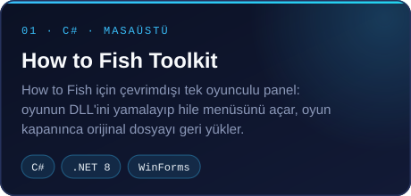
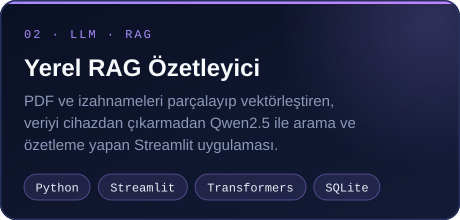
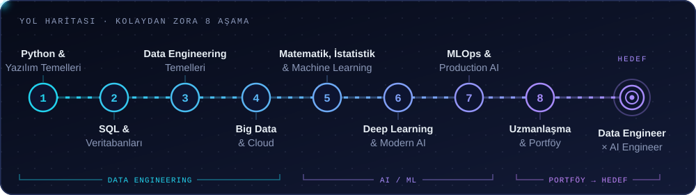

<a href="https://github.com/traldo44">
  
</a>

<p align="center">
  
</p>

<p align="center">
  <a href="https://www.linkedin.com/in/mertaydingunes/"></a>
  <a href="mailto:aydingunesmert@gmail.com"></a>
  
  
</p>

## ⚡ 01 // MERHABA, BEN MERT

Karabük Üniversitesi'nde **Bilgisayar Mühendisliği 4. sınıf** öğrencisiyim ve bölüm birincisiyim (GNO **3.86 / 4.00**). Web geliştirmeyle başladım ve **Full-Stack Developer** olarak uçtan uca uygulamalar geliştiriyorum.

Asıl tutkum **veri**: veriyi toplayan, temizleyen ve anlamlı hale getiren sistemler kurmak, sonra bu verinin üzerine **yapay zekâ modelleri** inşa etmek. Öğrendiğim her şeyi bir projeye dökmeyi seviyorum: fotoğraftan kalori tahmin eden bir model, verini hiç dışarı çıkarmayan bir RAG uygulaması ya da staj ilanlarını benim yerime tarayan bir bot.

```python
class Mert:
    unvan    = "Full-Stack Developer → Data Engineer × AI Engineer"
    okul     = "Karabük Üniversitesi · Bilgisayar Mühendisliği · 4. sınıf"
    derece   = "Bölüm 1.si · GNO 3.86 / 4.00"
    su_an    = ["Fotoğraftan kalori tahmini (PyTorch)",
                "HSD Türkiye platformu (Next.js)"]
    diller   = {"Türkçe": "ana dil", "English": "B2"}

    def motto(self):
        return "Öğren → uygula → proje yap → paylaş. Her gün biraz daha iyi."
```

<details>
<summary>🇬🇧 <b>English</b></summary>
<br />

I'm **Mert**, a 4th-year Computer Engineering student at Karabük University, ranked **1st in my department** (GPA 3.86/4.00). I started with web development and build end-to-end apps as a **Full-Stack Developer**.

I'm heading toward **Data Engineering and AI**: building systems that collect, clean and make sense of data, then putting models on top of it. Right now I'm training a model that estimates calories from a single food photo. I'm open to Data and AI internship and junior opportunities.

</details>

## 🛠️ 02 // TEKNOLOJİLER

<p align="center"><b>Veri & Yapay Zekâ</b></p>
<p align="center">
  <br /><br />
  
  
  
  
  
  
</p>

<p align="center"><b>Web & Uygulama</b></p>
<p align="center">
  
</p>

<p align="center"><b>Diller & Araçlar</b></p>
<p align="center">
  
</p>

## 👾 03 // ÖNE ÇIKAN PROJELER

<p align="center">
  <a href="https://github.com/traldo44/How-to-Fish-Toolkit"></a>
  <a href="https://github.com/traldo44/local-rag-project-with-streamlit"></a>
  <a href="https://github.com/sicloid/hubify"></a>
  <a href="https://github.com/traldo44/kalori-tahmini"></a>
</p>

<p align="center"><sub>Hubify canlı demo: <a href="https://hubify-olive.vercel.app">hubify-olive.vercel.app</a></sub></p>

<details>
<summary><b>Diğer projeler</b></summary>
<br />

| Proje | Ne yapıyor? | Teknoloji |
| --- | --- | --- |
| **Staj Radar** 🔒 | Yaklaşık 1000 kariyer sayfasını düzenli tarayıp yeni staj ilanlarını Telegram'dan haber veren kişisel bot | Python, Telegram Bot API |
| [**HSD Türkiye Platformu**](https://hsdturkiye.com) | Öğrenci geliştirici topluluğunun sitesi ve yönetim sistemi; rozet sistemi ve Mattermost tabanlı sohbet entegrasyonu (ekip projesi) | Next.js, TypeScript, Prisma |
| [**URL → MP4 / MP3**](https://github.com/traldo44/URL-to-MP4-MP3-converter) | Video ve ses bağlantılarını MP4 ya da MP3'e çeviren, tek dosya .exe olarak dağıtılan masaüstü uygulaması | Python, Tkinter, yt-dlp |
| [**Laravel E-Ticaret**](https://github.com/traldo44/Laravel1j-e-commerce) | Laravel ile geliştirilmiş e-ticaret sitesi | PHP, Laravel, Tailwind |
| [**Görsel Programlama Projesi**](https://github.com/traldo44/visual-programming-project) | Çok formlu Windows Forms masaüstü uygulaması | C#, .NET |

</details>

## 🎯 04 // YOL HARİTAM

<p align="center">
  
</p>

## 🐍 05 // AKTİVİTE

<p align="center">
  <picture>
    <source media="(prefers-color-scheme: dark)" srcset="https://raw.githubusercontent.com/traldo44/traldo44/output/github-snake-dark.svg" />
    <source media="(prefers-color-scheme: light)" srcset="https://raw.githubusercontent.com/traldo44/traldo44/output/github-snake.svg" />
    
  </picture>
</p>


